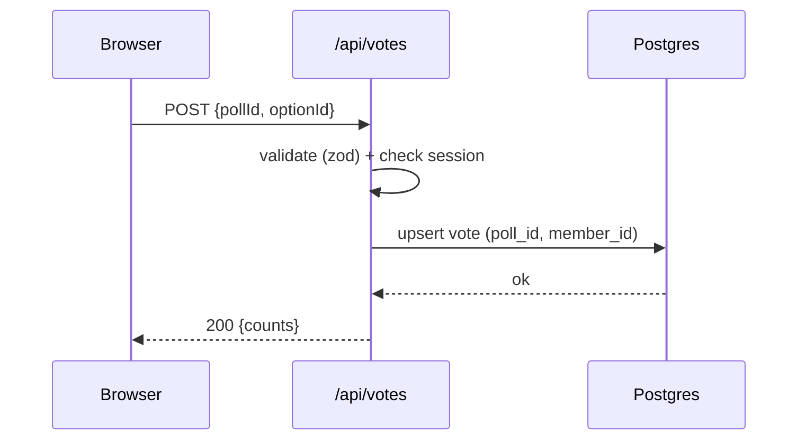

# /explain — Understand anything in this project

> **Role:** mentor · **Input:** a file, symbol, error, concept or the recent conversation · **Output:** an explanation (no file changes) · **Next:** back to whatever you were doing

## What this does

Explains something so it actually makes sense — using the real code in this repo, not a textbook. Starts simple, goes deeper if asked, and ends with a question or two so the human can check they've got it. Never changes any files.

## Before you start

Work out what the argument is:

| Argument looks like                         | Treat as      |
| ------------------------------------------- | ------------- |
| A path (`apps/web/src/lib/poll.ts`)          | **File**      |
| A name (`closePoll`, `PollCard`)             | **Symbol** — find it with a search first |
| Text with `Error`, `Exception`, a stack trace, exit code | **Error** |
| A term (`OIDC`, `migration`, `server action`) | **Concept**  |
| `what just happened` / `why did you do that` / nothing | **Recap** of the recent steps in this conversation |
| A decision (`why Postgres?`, `why shadcn?`) | **Decision**  |

If the human didn't say how deep, start at **Practical** and offer the other levels at the end.

For a quick, single-turn explanation, answer directly in the main conversation. For something that needs reading many files (e.g. "explain how auth works end to end"), delegate to the **`mentor`** role with the question and the relevant paths, then relay its answer.

## Steps

### Step 1 — Read before you explain

- **File / symbol:** read it in full, plus what calls it and what it calls (one level each way). Find the scenario tag or spec it serves (`grep` for `@KEY-nn` / `KEY-nn` in tests and commits).
- **Error:** find where it came from — which command, which file and line. Read that code. If the error is from a tool (npm, Docker, gcloud), say which tool.
- **Concept:** find where it shows up in *this* repo (`docs/glossary.md`, stack profile, code). Explain it through that example.
- **Decision:** look in `docs/decisions/`, `specs/*/grill-log.md`, `specs/*/05-tech-plan.md`.
- **Recap:** reread the recent turns; list the actions taken and files changed.

### Step 2 — Explain at the right level

1. **Simple** — one everyday analogy, no jargon, three to five sentences.
2. **Practical** — what it is *here*, where it lives, the command to run, what success looks like, the most common mistake.
3. **Deep dive** — how it works underneath, trade-offs, alternatives considered, links to official docs (fetch to confirm a link if unsure).

Shape by type:

- **Error:** *What it says* (plain words) → *Where it came from* (file:line, command) → *Most likely cause* (and how you know) → *The one thing to try next* → *How to spot it next time*.
- **Code:** purpose (which scenario it serves) → the flow in order (data in → steps → data out) → one thing done well and why.
- **Decision:** options considered → cost of each → what we chose and why → what would make us change our mind → link to the ADR or grill-log entry.
- **Recap:** numbered list of what was done, each with *why*; files changed; what to check.

### Step 3 — Draw it when there are more than three moving parts

ASCII is fine in terminals that don't render Mermaid.

### Step 4 — Link the vocabulary

The first time you use a term, define it in half a sentence or link [`docs/glossary.md`](../../../docs/glossary.md). If a term the human needed isn't in the glossary, say *"This should be in the glossary — want me to add it?"* (adding it is a separate, explicit action).

### Step 5 — Check for understanding

End with one or two short questions they can answer in their head, tied to this code:

- *"If you wanted to let people change their vote after the deadline, which function would you change?"*
- *"Why does the health check deliberately not talk to the database?"*

Then: *"Want me to go deeper, go simpler, or give you a tiny exercise?"*

## Rules

- Read-only. Never edit files or run commands that change state.
- Short answer first; expand on request.
- Never say "obviously", "simply", "just", "trivial".
- If you're not sure, say so and say how to find out.

## Gate — before moving on

- [ ] The explanation points at real files/lines in this repo (where applicable)
- [ ] Jargon is defined or linked
- [ ] Ends with a check-yourself question

## Tell the human

The explanation itself is the message. Close with the check-yourself question(s) and the offer to go deeper or simpler.
