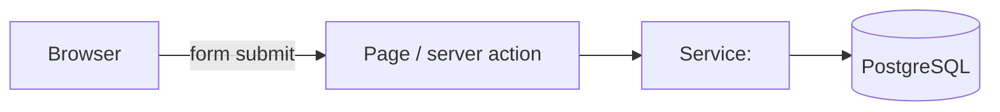

# Tech plan template

Copy into `specs/NNN-slug/05-tech-plan.md` and fill every section. If a section doesn't apply, write "None — <why>".

````markdown
# Tech plan — <Feature name>

> **Spec:** `specs/NNN-slug/` · **Status:** Draft | Approved (<YYYY-MM-DD>) · **Scenario key:** `<KEY>`
> **Stack:** <from Project Profile, e.g. Next.js App Router · Drizzle · PostgreSQL · Cloud Run> — see `docs/stacks/<profile>.md`
> **Inputs:** `01-prd.md` · `02-scenarios/` · `04-design/` <or "no design — backend only">

## 1. Context

<3–5 sentences: what we're building, what already exists that we reuse, what's new.>

**Reuses:** <existing modules, tables, components, auth>
**New:** <what this feature adds>

## 2. Architecture sketch



<One or two sentences walking through the main request flow.>

## 3. Components

| Component | Kind | Responsibility | New / changed |
| --- | --- | --- | --- |
| `<path or name>` | page / component / server action / service / table | <one line> | New |

## 4. Data model

### `<table_or_entity>`

| Field | Type | Constraints | Needed by |
| --- | --- | --- | --- |
| `id` | uuid | PK, default random | all |
| `<field>` | <type> | <not null, unique, FK, check> | @<KEY>-01 |

**Indexes:** <index and the query it serves>
**Migrations:** <new migration files; changes to existing tables>

## 5. API contracts

### `<METHOD> <path>` <or `serverAction <name>(input)`>

- **Auth:** <who may call it; checked on the server>
- **Input:** <schema — fields, types, validation rules>
- **Output (success):** <status + shape>
- **Errors:**

| Status | When | Scenario |
| --- | --- | --- |
| 400 | <validation fails> | @<KEY>-02 |
| 403 | <not a member> | @<KEY>-03 |

## 6. Tasks — thin vertical slices, in order

| ID | Scenarios | What changes | Files | Proven by | Size |
| --- | --- | --- | --- | --- | --- |
| T0 | — (skeleton) | <walking skeleton: page → server → DB → page, deployed> | <files> | `npm run verify` green, health check | M |
| T1 | @<KEY>-01 | <happy path for …> | <files> | scenario @<KEY>-01 + unit test `<name>` | S |
| T2 | @<KEY>-02, @<KEY>-03 | <validation for …> | <files> | scenarios @<KEY>-02, @<KEY>-03 | S |

**Scenario coverage:** every tag from `02-scenarios/` appears above. <List any deliberately deferred, with reason.>

## 7. Non-functional

| Area | Plan |
| --- | --- |
| Security | <authn, authz on server, input validation (schema library), secrets in env/secret manager, personal data handling> |
| Performance | <budgets from NFRs, query limits, indexes, caching (only if needed)> |
| Observability | <health endpoint, structured logs, error tracking, what alerts> |
| Accessibility | <WCAG 2.2 AA from NFRs/design; how it's tested (axe in e2e)> |

## 8. Decisions

| Decision | Choice | Why not the alternative | ADR |
| --- | --- | --- | --- |
| <e.g. ORM> | <Drizzle> | <Prisma — heavier client, slower cold starts on Cloud Run> | `docs/decisions/NNNN-title.md` or "stack default" |

## 9. Risks

| Risk | Likelihood | Impact | Mitigation |
| --- | --- | --- | --- |
| <risk> | Low / Med / High | Low / Med / High | <mitigation> |

## 10. Rollout and rollback

- **Rollout:** <feature flag? migration before deploy? order of steps>
- **Rollback:** <redeploy previous revision; migration down-path or forward-fix plan>

## 11. Open questions

| ID | Question | Recommended answer | Status |
| --- | --- | --- | --- |
| TQ1 | <question> | <recommendation> | Open |

## 12. Least-certain decisions (for `/grill tech-plan`)

1. <decision> — <why unsure>
2. …
3. …
````
