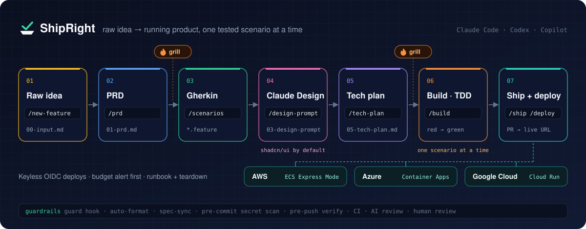

<p align="center">
  <picture>
    <source media="(prefers-color-scheme: dark)" srcset="docs/assets/logo-dark.svg">
    
  </picture>
</p>

<h1 align="center">ShipRight</h1>

<p align="center">
  From a messy idea to a deployed product: spec first, test first, every decision grilled.<br/>
  An agentic harness that helps junior developers vibe-code like seniors.
</p>

<p align="center">
  
  <a href="https://github.com/nossulenko/shipright/stargazers"></a>
  <a href="https://github.com/nossulenko/shipright/actions/workflows/ci.yml"></a>
  <a href="LICENSE"></a>
  
  
  
  
  
  
</p>

<p align="center">
  
</p>

## What is ShipRight?

Drop in raw input (meeting notes, a Slack thread, a one-line idea) and ShipRight walks it to production. It becomes a **PRD**, then **Gherkin scenarios**, then a **Claude Design prompt** that generates your frontend, then **tested code**, and finally a **live URL on AWS, Azure or Google Cloud**. Twelve AI roles cover the whole SDLC, and a **griller** challenges every decision while it is still cheap to change. Deterministic guardrails keep the agent from doing anything you'd regret. It runs in **Claude Code**, **Codex** and **GitHub Copilot**, and it is built for **junior developers**: every step explains itself.

- 📝 **Spec-driven, end to end.** Raw input → PRD → Gherkin → design → tech plan → code. Every scenario carries a tag (`@LUNCH-03`) that follows it into the design, tests, commits and PRs.
- 🔥 **A griller for your decisions.** An adversarial reviewer asks the question you forgot and offers its own best answer. Every decision gets a verdict: ✅ defended, ⚠️ accepted risk, or ❌ revise.
- 🎨 **Claude Design, wired in.** `/design-prompt` writes a copy-paste prompt that maps screens to scenarios, demands every UI state and fixes the output format, using **shadcn/ui by default**. `/import-design` then turns the export into real components.
- 🧑‍🤝‍🧑 **An AI team for the whole SDLC.** Product manager, business analyst, UX designer, architect, griller, frontend, backend, QA, security, DevOps, code reviewer, and a mentor who explains it all.
- ☁️ **Deploy skills for AWS, Azure & GCP.** ECS Express Mode, Container Apps or Cloud Run. CI logs in without stored keys (OIDC), a budget alert is set before the first resource, and every deploy leaves a runbook with rollback and teardown steps.
- 🛡️ **Guardrails instead of babysitting.** Hooks block destructive commands, unconfirmed cloud spend and secrets in code. Git hooks and CI run the same `npm run verify` on Node, Python, Go or .NET.
- 🎓 **Junior-first.** Teaching mode explains every step, `/next` always says what to do, `/explain` answers "what just happened?", and the [glossary](docs/glossary.md) is one click away.

```text
/start                     # 2 minutes: pick your stack, cloud and design library
/scaffold                  # create the app for that stack, tests and Dockerfile included
/new-feature notes.md      # raw idea → PRD → 🔥 grill → Gherkin → Claude Design prompt
/import-design             # Claude Design export → shadcn/ui components
/tech-plan  →  /grill      # how we'll build it, then try to break it
/build @LUNCH-01           # one scenario at a time: red → green → refactor
/ship                      # verify, review, open a pull request
/deploy                    # Cloud Run · Container Apps · ECS Express Mode
```

## Quick start

**1. Get the template**

Click **Use this template** on GitHub, or:

```bash
git clone https://github.com/nossulenko/shipright.git my-product
cd my-product
npm run setup        # turns on the git hooks and checks your tools (Node 20+, git, gh)
```

**2. Open your coding agent in the folder and run `start`**

| Runtime            | Launch    | Then        |
| ------------------ | --------- | ----------- |
| Claude Code        | `claude`  | `/start`    |
| Codex              | `codex`   | `$start`    |
| GitHub Copilot CLI | `copilot` | `/start`    |

`/start` asks a few questions, one at a time and always with a recommended answer, then fills in the **Project Profile** in [`AGENTS.md`](AGENTS.md). Next comes `/scaffold` to create the app, then `/new-feature` with your idea.

> **New to all this?** Read [the workflow guide](docs/workflow.md) and keep the [glossary](docs/glossary.md) open.
> **Want to see the finished result first?** Browse the [team lunch poll example](examples/team-lunch-poll/), with every artifact from raw Slack thread to tech plan.
> **Already have a repo?** Tell your agent: *"Read ADOPT.md and follow it."* See [`ADOPT.md`](ADOPT.md).

## The pipeline

| #  | Stage         | Command                       | Who does it                       | You get                                              |
| -- | ------------- | ----------------------------- | --------------------------------- | ---------------------------------------------------- |
| 00 | Capture       | `/new-feature`                | product-manager                   | `00-input.md`: your raw input, verbatim              |
| 01 | PRD           | `/prd`                        | product-manager                   | `01-prd.md`: problem, users, scope, `FR-n` / `NFR-n` |
| 🔥 | Grill         | `/grill`                      | griller                           | `grill-log.md`: questions, answers, verdicts         |
| 02 | Scenarios     | `/scenarios`                  | business-analyst                  | `02-scenarios/*.feature`: tagged Gherkin             |
| 03 | Design prompt | `/design-prompt`              | ux-designer                       | `03-design-prompt.md`, ready to paste into Claude Design |
| 04 | Design import | `/import-design`              | frontend-engineer                 | real components built from the `04-design/` export   |
| 05 | Tech plan     | `/tech-plan`                  | architect                         | `05-tech-plan.md` + ADRs                             |
| 🔥 | Grill         | `/grill`                      | griller                           | verdicts on the plan, before any code exists         |
| 06 | Build         | `/build`                      | frontend · backend · qa engineers | tested code, one commit per scenario                 |
| 07 | Review        | `/review` · `/security-check` | code-reviewer · security-reviewer | ranked findings with `file:line` and a fix           |
| 08 | Ship          | `/ship`                       | devops-engineer                   | a PR with test evidence and a rollback plan          |
| 09 | Deploy        | `/deploy`                     | devops-engineer                   | a live URL + `docs/deploy/<cloud>.md` runbook        |

Each stage writes one file into `specs/NNN-feature/`, and each one ends with a gate you approve. Lost? **`/next`** reads your spec folder and git state and gives you the single next command.

## Claude Design handoff

The step where most vibe-coded products fall apart is **design → code**. The design tool invents components that don't exist, and the code drifts away from the design. ShipRight closes the gap from both ends.

`/design-prompt` turns your scenarios into a prompt for [Claude Design](https://claude.com/design): screens mapped to scenario tags, every empty / loading / error / success state, real copy, WCAG 2.2 AA, responsive rules. It always ends with a fixed **output format**, so the export can be imported mechanically:

```text
9. OUTPUT FORMAT (required)
1. Clickable prototype — wire the flows so they can be clicked through.
2. One artboard per screen × state, named NN-screen-name--state  (01-poll-list--empty, 03-poll-detail--closed)
3. Name every layer with its shadcn/ui name (Card, Button, Dialog); custom compositions in PascalCase (PollCard).
4. A canvas note beside every artboard listing the scenarios it satisfies: "Scenarios: @LUNCH-04, @LUNCH-05".
5. One THEME TOKENS note with the final theme as a shadcn/ui CSS block:  :root { --primary: …; }  .dark { … }
6. Stay in scope — anything missing becomes an "OPEN QUESTION:" note, never an invented feature.
7. Real content only — the copy and sample data from section 6.
8. Deliver: Export → Hand off to Claude Code (preferred), or HTML (.zip) + PDF, into specs/NNN-slug/04-design/.
```

**shadcn/ui on Tailwind CSS with lucide-react icons is the default** ([ADR-0002](docs/decisions/0002-shadcn-ui-default-design-library.md)). Put MUI, Mantine, Chakra, Ant Design or your in-house system in the Project Profile and every prompt, import and scaffold switches to it. Once the export is in `04-design/`, `/import-design` runs `npx shadcn@latest add` for exactly the components it names, copies the theme tokens and builds one route per artboard. Scenario tags become `data-testid` hooks, and the result is checked against the export with Playwright screenshots.

## Meet the griller

The griller walks the decision tree one question at a time. Each question explains why it matters and comes with the griller's own recommended answer. Taken from the [example grill log](examples/team-lunch-poll/grill-log.md):

```text
Q2 [Security] Your notes say "no login please". Without sign-in, what stops someone
   voting twice, or someone outside the team voting?

   Why this matters  "One vote per person" (FR-3) can't be enforced if we don't know who
                     the person is. A private browser window could vote again.
   Recommended       Sign in with the company Google account everyone already has.
   Answer            Hadn't thought of private windows. Google account is fine.
   Verdict           ❌ Revise → applied: FR-7 added (Google sign-in, team members only)
```

Run `/grill` on a PRD, tech plan, ADR, PR, dependency or cloud choice, or on any decision you type in. Pick `gentle` (more explanation), `standard`, or `brutal`. Every session is appended to `grill-log.md`, and hard-to-reverse outcomes become ADRs.

## Your AI team

| Role                   | What it does                                                         | Edits      |
| ---------------------- | -------------------------------------------------------------------- | ---------- |
| 🧭 `product-manager`   | Raw input → PRD: problem, users, scope, success metrics              | specs      |
| 🥒 `business-analyst`  | PRD → Gherkin: edge cases, error paths, coverage matrix               | specs      |
| 🎨 `ux-designer`       | Scenarios → Claude Design prompt: flows, states, accessibility        | specs      |
| 🏛️ `architect`         | Tech plan, data model, API contracts, ADRs                            | docs       |
| 🔥 `griller`           | Adversarial review of any decision, plan or PR                        | read-only  |
| 🖥️ `frontend-engineer` | UI, design import, components, client state                           | code       |
| ⚙️ `backend-engineer`  | APIs, data access, migrations, jobs                                   | code       |
| 🧪 `qa-engineer`       | Step definitions, test strategy, flaky-test triage                    | tests      |
| 🛡️ `security-reviewer` | OWASP-style review: secrets, auth, injection, dependencies            | read-only  |
| 🚀 `devops-engineer`   | Containers, CI/CD, cloud deploys, runbooks                            | infra      |
| 🔍 `code-reviewer`     | Pre-PR review against the review lenses                               | read-only  |
| 🎓 `mentor`            | Explains code, errors, concepts and decisions at your level           | read-only  |

Each role is written once in [`.agents/roles/`](.agents/roles/), and `npm run sync:agents` generates the adapters for Claude Code (`.claude/agents/`), Codex (`.codex/agents/`) and Copilot (`.github/agents/`). Read-only roles really are read-only: the checker rejects a reviewer that lists an edit or shell tool.

## Deploy anywhere

Every cloud skill follows the same steps: preflight (it shows your account and region and asks before creating anything) → budget alert → containerise and run locally → first deploy by hand → secrets → optional Postgres → GitHub Actions with keyless OIDC → smoke test → runbook. Adding a cloud means adding one skill, with no core changes.

| Cloud            | Runs your app on | Database                      | Secrets         | CI login (no stored keys)    | Budget alert | Runbook + teardown |
| ---------------- | ---------------- | ----------------------------- | --------------- | ---------------------------- | :----------: | :----------------: |
| **Google Cloud** | Cloud Run        | Cloud SQL for PostgreSQL      | Secret Manager  | Workload Identity Federation | ✅           | ✅                 |
| **Azure**        | Container Apps   | Azure Database for PostgreSQL | Key Vault       | OIDC federated credential    | ✅           | ✅                 |
| **AWS**          | ECS Express Mode | RDS for PostgreSQL            | Secrets Manager | IAM OIDC role                | ✅           | ✅                 |

> AWS App Runner stopped accepting new customers on 30 April 2026, so `/deploy-aws` uses **ECS Express Mode**, AWS's recommended successor, and warns you off older tutorials.

## Cross-stack

ShipRight is opinionated by default and flexible when you need it to be. `/start` records your stack, `/scaffold` builds it from the matching [stack profile](docs/stacks/README.md), and `npm run verify` auto-detects every app under `apps/` and runs its gates.

| Profile                                                | Kind            | BDD runner (runs your `.feature` files) |
| ------------------------------------------------------ | --------------- | ---------------------------------------- |
| [Next.js + shadcn/ui](docs/stacks/nextjs-shadcn.md) ⭐ | full-stack web  | playwright-bdd                           |
| [React (Vite) + shadcn/ui](docs/stacks/react-vite-shadcn.md) | SPA       | playwright-bdd                           |
| [Node API (Fastify)](docs/stacks/node-api.md)          | API             | @cucumber/cucumber                       |
| [Python (FastAPI)](docs/stacks/python-fastapi.md)      | API             | pytest-bdd                               |
| [.NET (ASP.NET Core)](docs/stacks/dotnet-api.md)       | API             | Reqnroll                                 |
| [Go](docs/stacks/go-api.md)                            | API             | godog                                    |

⭐ = the recommended default for juniors: one app, one deploy, TypeScript end to end.

## Guardrails

The agent is fast, tireless and fallible. Instead of reviewing every line, ShipRight stacks deterministic checks. Each one is imperfect, but together they are very hard to slip past:

```text
PreToolUse guard    blocks rm -rf /, force-push to main, DROP TABLE, secrets in code;
                    asks before cloud spend, cloud deletes, .env writes and guardrail edits
PostToolUse format  prettier / ruff / gofmt on every file the agent touches
Stop spec-sync      after app code changes, reminds the agent once to sync specs, PROGRESS.md and docs
pre-commit          no commits on main, no .env files, secret scan, harness check
pre-push            npm run verify (harness + every app's lint, types, tests, BDD, build)
CI                  the same verify on every push, plus "no PROGRESS.md in PRs"
AI review           code-reviewer, security-reviewer and griller roles
Human review        spot-checking: the last slice, not the only one
```

## Works with Claude Code, Codex & Copilot

| Runtime            | Contract                      | Skills                                     | Roles             | Hooks                         | MCP                  |
| ------------------ | ----------------------------- | ------------------------------------------ | ----------------- | ----------------------------- | -------------------- |
| Claude Code        | `CLAUDE.md` → `@AGENTS.md`    | `.claude/skills` → symlink to `.agents/skills` | `.claude/agents/` | `.claude/settings.json`       | `.mcp.json`          |
| Codex              | `AGENTS.md`                   | `.agents/skills/`                          | `.codex/agents/`  | `.codex/hooks.json`           | `.codex/config.toml` |
| GitHub Copilot CLI | `AGENTS.md`                   | `.agents/skills/`                          | `.github/agents/` | `.github/hooks/shipright.json` | `.mcp.json`         |

Two MCP servers come pre-wired: **Playwright**, so the agent can open and click through the running app, and **shadcn**, so it can browse and install components. User-invoked-only skills (`start`, `ship`, `deploy`, `deploy-*`) are guarded on every runtime. They never run unless you name them.

## Project layout

```
AGENTS.md              the agent contract + your Project Profile (read by every runtime)
CLAUDE.md              one line: @AGENTS.md
ADOPT.md               playbook for bringing ShipRight into an existing repo
.agents/skills/        19 skills: the pipeline, build/review/ship, deploy-aws|azure|gcp, mentor
.agents/roles/         12 SDLC roles (source of truth for every runtime's subagents)
.claude/ .codex/ .github/agents/   generated runtime adapters + hook wiring
specs/                 your features: specs/NNN-slug/00-input.md … 05-tech-plan.md
examples/              a complete worked example (team lunch poll)
apps/                  your code, created by /scaffold (apps/web, apps/api, …)
docs/workflow.md       the pipeline, stage by stage
docs/stacks/           cross-stack profiles: commands, layout, BDD runner, Dockerfile, cloud fit
docs/standards/        engineering, testing and security standards the agents code against
docs/decisions/        ADRs (immutable), docs/architecture/ = current state
docs/deploy/           runbooks written by the deploy skills
scripts/               verify, verify-harness, sync-agents, setup + hooks/ (guard, format, spec-sync)
.githooks/             pre-commit and pre-push
```

## Development

Working on the harness itself:

```bash
npm run verify:harness   # skills, roles, adapters in sync, AGENTS.md tables, links, Gherkin tags
npm run sync:agents      # regenerate runtime adapters after editing .agents/roles/
npm run verify           # harness + every app under apps/
```

No npm dependencies: the scripts are plain Node 20+. CI runs `npm run verify` on every push and PR, and it switches on the Python, Go, .NET and pnpm toolchains automatically once an app needs them. See [CONTRIBUTING.md](CONTRIBUTING.md) for how to add a skill, a role or a stack profile.

**Troubleshooting:** on Windows, `.claude/skills` is a symlink. Run `git config --global core.symlinks true` (with Developer Mode on) before cloning, otherwise Claude Code won't see the skills. `npm run verify:harness` warns you if the link was checked out as a plain file.

## Status & roadmap

Alpha. The contract, the pipeline skills, the twelve roles, the guardrails, the verifier and the three cloud deploy skills are in place, along with a fully worked example spec. Not yet:

- a recorded end-to-end demo
- Terraform / Bicep variants of the deploy skills
- more stack profiles (Java/Spring, Rails, mobile)
- Jira and Azure DevOps tracker sync
- an eval suite that scores skill output against the example

Contributions welcome.

## License

[MIT](LICENSE) © Nikolai Nossulenko
