# The ShipRight workflow

This page walks one feature from a messy idea to a running URL. Every stage produces one file you can read, so you always know where you are. If you get lost, type `/next`.

```mermaid
flowchart LR
    A[💡 Raw input<br/><code>00-input.md</code>] --> B[📄 PRD<br/><code>01-prd.md</code>]
    B --> G1{{🔥 Grill}}
    G1 --> C[🥒 Gherkin<br/><code>02-scenarios/*.feature</code>]
    C --> D[🎨 Claude Design prompt<br/><code>03-design-prompt.md</code>]
    D --> E[🖼️ Design export<br/><code>04-design/</code>]
    E --> F[🧭 Tech plan<br/><code>05-tech-plan.md</code>]
    F --> G2{{🔥 Grill}}
    G2 --> H[🧱 Build<br/>one scenario at a time]
    H --> I[🔍 Review + security]
    I --> J[📦 Ship<br/>pull request]
    J --> K[🚀 Deploy<br/>AWS · Azure · GCP]
```



---

## 1. Capture — `/new-feature`

Paste anything: meeting notes, a Slack thread, a voice-memo transcript, one sentence. ShipRight saves it **verbatim** in `specs/NNN-slug/00-input.md`. Nothing is lost, and every later decision can be traced back to what was actually said.

`/new-feature` then carries you through stages 1–4 with a checkpoint after each. You can stop at any checkpoint and resume later.

## 2. PRD — `/prd`

The **product-manager** role turns the raw input into a Product Requirements Document: the problem, who has it, what success looks like, what is *out* of scope, and numbered requirements (`FR-1`, `NFR-1`…). It asks you one question at a time, always with a recommended answer, and marks anything it assumed.

> **Why a PRD?** Because "build a lunch poll" means ten different things to ten people. The PRD is where you pick one.

## 3. Grill — `/grill`

The **griller** role tries to break your decisions before reality does: *Who exactly is the user? What happens when two people vote at the same second? Why not just use a Slack poll?* Each question comes with the griller's own recommended answer, and each decision gets a verdict:

| Verdict | Meaning |
| ------- | ------- |
| ✅ defended | You had a good answer. Locked in. |
| ⚠️ accepted risk | A real weakness you chose to live with — written down. |
| ❌ revise | Go back and change the PRD or plan. |

Everything lands in `grill-log.md`. Big, hard-to-reverse outcomes become ADRs in `docs/decisions/`.

## 4. Gherkin — `/scenarios`

The **business-analyst** role turns each requirement into concrete examples in Gherkin, a plain-English format that is *also* an executable test:

```gherkin
@LUNCH-03 @FR-2 @happy
Scenario: A member votes for a restaurant
  Given an open poll "Friday lunch" with options "Pho" and "Tacos"
  When Sam votes for "Tacos"
  Then "Tacos" shows 1 vote
  And Sam cannot vote again in this poll
```

Every scenario carries a **scenario tag** (`@LUNCH-03`) and a **requirement tag** (`@FR-2`). Those tags follow the work into the design, the tests, the commits and the PR — that is how you prove every requirement was built.

## 5. Claude Design prompt — `/design-prompt`

The **ux-designer** role turns the scenarios into a copy-paste prompt for [Claude Design](https://claude.com/design). The prompt always includes:

- every screen, mapped to the scenario tags it satisfies, with its empty / loading / error / success states,
- real copy and sample data (no lorem ipsum), accessibility (WCAG 2.2 AA) and responsive rules,
- the **design library** — **shadcn/ui on Tailwind + lucide-react by default**, or whatever the Project Profile names,
- a mandatory **OUTPUT FORMAT** block: artboards named `NN-screen--state`, shadcn component names, a canvas note per artboard listing its scenario tags, the theme as a shadcn `:root {…} .dark {…}` token block, and delivery via **Export → Hand off to Claude Code** (or HTML .zip as a fallback).

You paste it into Claude Design, iterate visually, export, and drop the export into `specs/NNN-slug/04-design/`.

## 6. Import the design — `/import-design`

The **frontend-engineer** role reads the export, installs exactly the shadcn components it names, copies the theme tokens into the app, and builds one route or component per artboard, wired to mock data first. Scenario tags become `data-testid` hooks so the Gherkin tests can find each element. Playwright screenshots are compared against the export.

## 7. Tech plan — `/tech-plan`

The **architect** role decides *how*: a Mermaid diagram, the data model, API contracts, and an ordered list of thin **vertical slices**, each mapped to scenario tags, files and tests. Consequential choices become ADRs. Then grill it again — this is the cheapest moment to change your mind.

## 8. Build — `/build`

One scenario at a time:

```
bind steps ─► run ─► 🔴 see it fail for the right reason ─► minimal code ─► 🟢 pass ─► refactor ─► npm run verify ─► commit [LUNCH-03]
```

The engineers (frontend, backend, qa) split the work when it helps. If the spec is ambiguous, the build stops and asks — it never silently invents behaviour.

## 9. Review — `/review` and `/security-check`

The **code-reviewer** and **security-reviewer** roles look at the branch with fresh eyes: spec match, correctness, test quality, accessibility, security, readability, docs. Findings come ranked with `file:line` and a suggested fix.

## 10. Ship — `/ship`

Runs `npm run verify`, makes sure `PROGRESS.md` is folded into the docs, commits, pushes, and opens a pull request with the spec link, scenario tags, test evidence and a rollback plan. It asks before pushing.

## 11. Deploy — `/deploy`

Routes to the cloud in your Project Profile:

| Cloud | Default home for your app | Database | Secrets | CI login |
| ----- | ------------------------- | -------- | ------- | -------- |
| Google Cloud | Cloud Run | Cloud SQL for PostgreSQL | Secret Manager | Workload Identity Federation |
| Azure | Container Apps | Azure Database for PostgreSQL | Key Vault | OIDC federated credential |
| AWS | ECS Express Mode | RDS for PostgreSQL | Secrets Manager | IAM OIDC role |

Each deploy skill checks your login and shows you the account and region **before** creating anything, sets a budget alert first, deploys by hand once so you see every step, then wires up GitHub Actions with keyless OIDC login, and writes a runbook to `docs/deploy/<cloud>.md` — including how to roll back and how to tear everything down.

---

## Shortcuts

| You want to… | Type |
| ------------ | ---- |
| Know what to do next | `/next` |
| Understand something | `/explain <file, error or concept>` |
| Stress-test a choice | `/grill <decision>` |
| Change stack or cloud | `/start` (re-runnable) |
