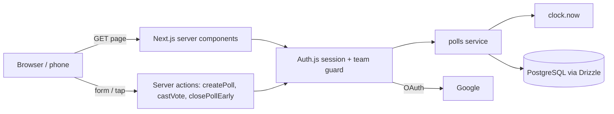

# Tech plan — Team lunch poll

> **Spec:** `examples/team-lunch-poll/` · **Status:** Approved (2026-11-20, after [grill session 2](grill-log.md)) · **Scenario key:** `LUNCH`
> **Stack:** Next.js App Router · TypeScript · shadcn/ui · Auth.js (Google) · Drizzle ORM · PostgreSQL · playwright-bdd · Cloud Run + Cloud SQL — see `docs/stacks/nextjs-shadcn.md`
> **Inputs:** [`01-prd.md`](01-prd.md) · [`02-scenarios/`](02-scenarios/) · [`03-design-prompt.md`](03-design-prompt.md) / `04-design/`

## 1. Context

Lunchpoll is a new app, so this plan starts with a walking skeleton. Everything runs in one Next.js app: pages render on the server, mutations are server actions, data lives in PostgreSQL through Drizzle. Sign-in is Google via Auth.js, restricted to the company domain, and access to a team's polls is checked on every request against a `team_members` table.

**Reuses:** nothing yet — first feature.
**New:** the app itself, auth, teams/members, polls, options, votes.

## 2. Architecture sketch

A request hits a page or server action → the team guard loads the session and checks membership → the polls service reads or writes through Drizzle. "Open" vs "closed" is **derived** from `closes_at`, `closed_early_at` and `clock.now()` — there is no scheduler (see §8).

## 3. Components

| Component | Kind | Responsibility | New / changed |
| --- | --- | --- | --- |
| `apps/web/app/(auth)/sign-in/page.tsx` | page | Screen 01 — Google sign-in, `from-poll` notice | New |
| `apps/web/app/t/[team]/page.tsx` | page | Screen 02 — poll list, empty and no-access states | New |
| `apps/web/app/t/[team]/new/page.tsx` | page | Screen 03 — new poll form | New |
| `apps/web/app/t/[team]/p/[pollId]/page.tsx` | page | Screen 04 — vote, results | New |
| `apps/web/components/polls/*` | components | `PollCard`, `VoteOptionRow`, `PollResultHeading` | New |
| `apps/web/lib/auth.ts` | module | Auth.js config, Google provider, domain check | New |
| `apps/web/lib/team-guard.ts` | module | `requireMember(teamSlug)` → user + team or throws | New |
| `apps/web/lib/clock.ts` | module | `now()` — real time, overridable in tests | New |
| `apps/web/lib/polls/service.ts` | module | create, vote, close, list, results (pure logic + queries) | New |
| `apps/web/lib/polls/actions.ts` | server actions | `createPoll`, `castVote`, `closePollEarly` | New |
| `apps/web/db/schema.ts` | Drizzle schema | tables in §4 | New |
| `apps/web/app/api/health/route.ts` | route | `GET /api/health` → 200 + DB ping | New |

## 4. Data model

Auth.js's Drizzle adapter adds its standard `users`, `accounts`, `sessions` and `verification_tokens` tables. Ours:

### `teams`

| Field | Type | Constraints | Needed by |
| --- | --- | --- | --- |
| `id` | uuid | PK | all |
| `slug` | text | unique, not null | URLs `/t/platform` |
| `name` | text | not null | @LUNCH-05 heading |
| `time_zone` | text | not null, default `Europe/Brussels` | @LUNCH-04 "later today" |

### `team_members`

| Field | Type | Constraints | Needed by |
| --- | --- | --- | --- |
| `team_id` | uuid | FK → teams, PK part | @LUNCH-06 |
| `user_id` | text | FK → users, PK part | @LUNCH-06, @LUNCH-12 |
| `added_at` | timestamptz | not null, default now | audit |

### `polls`

| Field | Type | Constraints | Needed by |
| --- | --- | --- | --- |
| `id` | uuid | PK | all |
| `team_id` | uuid | FK → teams, not null | @LUNCH-01, @LUNCH-06 |
| `title` | varchar(60) | not null, check length ≥ 1 | @LUNCH-02 |
| `created_by` | text | FK → users, not null | @LUNCH-17, @LUNCH-18 |
| `closes_at` | timestamptz | not null | @LUNCH-04, @LUNCH-11, @LUNCH-14 |
| `closed_early_at` | timestamptz | null | @LUNCH-17 |
| `created_at` | timestamptz | not null, default now | @LUNCH-01 ordering |

**Index:** `(team_id, created_at desc)` — poll list query (@LUNCH-01, @LUNCH-05).

### `poll_options`

| Field | Type | Constraints | Needed by |
| --- | --- | --- | --- |
| `id` | uuid | PK | all |
| `poll_id` | uuid | FK → polls on delete cascade | @LUNCH-01 |
| `label` | varchar(60) | not null | @LUNCH-01 |
| `vegetarian_friendly` | boolean | not null, default false | @LUNCH-07 |
| `position` | smallint | not null; unique (poll_id, position) | display order |

### `votes`

| Field | Type | Constraints | Needed by |
| --- | --- | --- | --- |
| `poll_id` | uuid | FK → polls, PK part | @LUNCH-08 |
| `user_id` | text | FK → users, PK part | @LUNCH-10 (one vote per member) |
| `option_id` | uuid | FK → poll_options, not null | @LUNCH-08, @LUNCH-09 |
| `updated_at` | timestamptz | not null | @LUNCH-09 |

The composite primary key `(poll_id, user_id)` makes a double vote impossible at the database level; `castVote` is an upsert (`insert … on conflict (poll_id, user_id) do update set option_id = …`). Results are counted with `group by option_id` — **no query ever returns `user_id` to the client** (@LUNCH-13).

**Migrations:** `0001_init.sql` generated by `drizzle-kit generate`; applied by `drizzle-kit migrate` before the app starts on deploy.

## 5. API contracts

All mutations are server actions returning `{ ok: true, data } | { ok: false, error: Code, fieldErrors? }`. Every action calls `requireMember(teamSlug)` first.

### `createPoll(teamSlug, { title, closesAt, options[] })`

- **Auth:** signed-in member of the team.
- **Input:** `title` 1–60 chars (trimmed); `options` 2–8 items, each `{ label: 1–60 chars, vegetarianFriendly: boolean }`; `closesAt` HH:mm interpreted in the team's time zone, must be after `clock.now()` and on the same calendar day. Validated with a Zod schema shared with the form.
- **Output:** `{ pollId }` → redirect to poll list with toast.
- **Errors:**

| Code | When | Scenario |
| --- | --- | --- |
| `VALIDATION` (`fieldErrors.title`) | title empty or > 60 | @LUNCH-02 |
| `VALIDATION` (`fieldErrors.options`) | < 2 or > 8 options | @LUNCH-03 |
| `VALIDATION` (`fieldErrors.closesAt`) | in the past or not today | @LUNCH-04 |
| `NOT_MEMBER` | not on the team | @LUNCH-06 |
| `UNAUTHENTICATED` | no session → redirect to sign-in | @LUNCH-12 |

### `castVote(teamSlug, pollId, optionId)`

- **Auth:** signed-in member of the poll's team.
- **Output:** updated counts per option + `myOptionId`.
- **Errors:**

| Code | When | Scenario |
| --- | --- | --- |
| `POLL_CLOSED` | `now ≥ closes_at` or `closed_early_at` set | @LUNCH-11 |
| `UNAUTHENTICATED` | no session → redirect to sign-in with `from-poll` notice | @LUNCH-12 |
| `NOT_MEMBER` | not on the team | @LUNCH-06 |
| `NOT_FOUND` | option not in this poll | — (defensive; tampered form) |

### `closePollEarly(teamSlug, pollId)`

- **Auth:** the poll's `created_by` only.
- **Errors:** `NOT_CREATOR` (@LUNCH-18), `POLL_CLOSED` (already closed → no-op success).

### `GET /api/health`

- 200 `{ status: "ok", db: "ok" }` when the database answers `select 1` within 1 s; 503 otherwise. Used by Cloud Run and `/deploy` smoke checks.

## 6. Tasks — thin vertical slices, in order

| ID | Scenarios | What changes | Files | Proven by | Size |
| --- | --- | --- | --- | --- | --- |
| T0 | — (skeleton) | Next.js app via `/scaffold`, Drizzle + local Postgres (Docker Compose), `/api/health`, `lib/clock.ts` with test override, playwright-bdd wired to `02-scenarios/`, one trivial passing step, deploy to Cloud Run | `apps/web/**`, `docker-compose.yml`, `playwright.config.ts` | `npm run verify` green; health 200 locally and on Cloud Run | M |
| T1 | @LUNCH-12, @LUNCH-06 | Auth.js Google sign-in with server-side domain check; `team_members` + seed script; `requireMember` guard; sign-in page incl. `from-poll`; poll list `no-access` state | `lib/auth.ts`, `lib/team-guard.ts`, `db/schema.ts`, `app/(auth)/sign-in/*`, `scripts/seed-team.ts` | scenarios @LUNCH-12, @LUNCH-06; unit tests for domain check | M |
| T2 | @LUNCH-05 | Poll list page with empty state (reads polls; none yet) | `app/t/[team]/page.tsx`, `components/polls/PollCard.tsx` | scenario @LUNCH-05 | S |
| T3 | @LUNCH-01 | `polls` + `poll_options` tables, `createPoll` happy path, new-poll form, list shows the new poll | `lib/polls/*`, `app/t/[team]/new/*` | scenario @LUNCH-01 | M |
| T4 | @LUNCH-02, @LUNCH-03, @LUNCH-04 | Zod schema shared by form + action; inline and summary errors; same-day check in team time zone | `lib/polls/schema.ts`, form | scenarios @LUNCH-02–04; unit tests for time-zone edge (23:59, DST change day) | S |
| T5 | @LUNCH-08, @LUNCH-13 | `votes` table, `castVote` insert, poll detail page with counts (no voter identities) | `lib/polls/*`, `app/t/[team]/p/[pollId]/*`, `VoteOptionRow` | scenarios @LUNCH-08 (desktop + 360 px viewport), @LUNCH-13 | M |
| T6 | @LUNCH-09, @LUNCH-10 | Upsert on `(poll_id, user_id)`; "Your vote" moves on change | `lib/polls/service.ts` | scenarios @LUNCH-09, @LUNCH-10 | S |
| T7 | @LUNCH-11, @LUNCH-14 | Derived status `isOpen(poll, now)`; reject late votes; results + winner heading | `lib/polls/status.ts`, `PollResultHeading` | scenarios @LUNCH-11, @LUNCH-14; unit tests for `isOpen` boundaries | M |
| T8 | @LUNCH-15, @LUNCH-16 | Tie and no-vote results | `lib/polls/results.ts` | scenarios @LUNCH-15, @LUNCH-16; unit tests for result calculation | S |
| T9 | @LUNCH-17, @LUNCH-18 | `closePollEarly` with creator check; confirm dialog; button hidden for non-creators | `lib/polls/actions.ts`, detail page | scenarios @LUNCH-17, @LUNCH-18 | S |
| T10 | @LUNCH-07 | Vegetarian-friendly checkbox and `Leaf` marker | form, `VoteOptionRow` | scenario @LUNCH-07 | S |

**Scenario coverage:** all 18 tags (`@LUNCH-01` … `@LUNCH-18`) appear above. Nothing deferred.

## 7. Non-functional

| Area | Plan |
| --- | --- |
| Security | Google sign-in via Auth.js; the `hd` hint is only a UI hint, so the `signIn` callback **also** rejects any email not ending in the company domain (grill session 2, Q6). Membership checked on the server in every page and action via `requireMember`. Zod validation on every action. Secrets (`AUTH_SECRET`, `AUTH_GOOGLE_ID`, `AUTH_GOOGLE_SECRET`, `DATABASE_URL`) in `.env` locally and Secret Manager on GCP. Voter identities never leave the server (NFR-4). |
| Performance | Pages are server-rendered; poll detail is one query for poll + options + grouped counts. Index on `(team_id, created_at)`. Budget: < 2 s on 4G (NFR-3), checked with a Lighthouse run in CI on the deployed preview. |
| Observability | `/api/health` with DB ping; structured JSON logs (`pino`) for every action with `pollId`, error code and duration — never `user_id` with `option_id` together; Cloud Run error reporting; alert on 5xx rate > 2% over 5 minutes. |
| Accessibility | shadcn/ui primitives; vote options are a `RadioGroup`; `@axe-core/playwright` runs on every screen in the e2e suite (NFR-1); @LUNCH-08 also runs at a 360 px viewport (NFR-2). |
| Testability | Scenarios mention clock times ("it is 11:00"). `lib/clock.ts` returns real time in production; when `NODE_ENV=test` it reads an `x-test-now` cookie set by the step definitions; the browser clock is set with Playwright's `page.clock`. |

## 8. Decisions

| Decision | Choice | Why not the alternative | ADR |
| --- | --- | --- | --- |
| Closing polls | Derive open/closed from `closes_at` at read time | A scheduler (Cloud Scheduler + endpoint) adds infrastructure, can fail silently, and still needs the same check on vote | would be proposed as `docs/decisions/0003-derive-poll-status.md` |
| Auth | Auth.js with Google provider, data in our Postgres | Managed auth (e.g. Clerk) is great but adds a vendor and cost for one sign-in method | would be proposed as `docs/decisions/0004-authjs-google.md` |
| ORM | Drizzle | Stack default (`docs/stacks/nextjs-shadcn.md`); light client, SQL-shaped, fast cold starts | stack default |
| Database hosting | Cloud SQL for PostgreSQL, smallest instance | Project Profile cloud is GCP; serverless Postgres elsewhere would split billing and networking | stack default |

## 9. Risks

| Risk | Likelihood | Impact | Mitigation |
| --- | --- | --- | --- |
| Time-zone bugs around "later today" | Med | Med | All comparisons in UTC with the team's time zone applied once, in `lib/polls/schema.ts`; unit tests for 23:59 and DST change days |
| Stale open page lets someone tap after closing | High | Low | Server rejects with `POLL_CLOSED` (@LUNCH-11); page refreshes to closed state |
| Cloud SQL idle cost for a tiny app | High | Low | Smallest instance; budget alert set before first deploy (grill session 2, Q5) |
| Test clock override leaks into production | Low | High | Override code path only compiled when `NODE_ENV=test`; unit test asserts it is ignored in production mode |

## 10. Rollout and rollback

- **Rollout:** T0 deploys the skeleton to Cloud Run on day one. Each task ships behind nothing — the app has one team and is invite-only by membership. Migrations run before the new revision receives traffic.
- **Rollback:** route traffic back to the previous Cloud Run revision (`gcloud run services update-traffic … --to-revisions=<previous>=100`). Migrations are additive in v1, so the old revision keeps working against the new schema.

## 11. Open questions

| ID | Question | Recommended answer | Status |
| --- | --- | --- | --- |
| TQ1 | Keep closed polls forever or purge? | Keep; list shows last 7 days only. Revisit if storage matters (it won't at this scale). | Answered: keep |
| TQ2 | Live-updating counts while the page is open? | Not in v1 — refresh on vote and on focus. Polling every 15 s if users ask. | Answered: not in v1 |

## 12. Least-certain decisions (for `/grill tech-plan`)

1. Deriving status instead of a scheduler — is there any scenario that needs an event *at* closing time?
2. Test clock override via cookie — safe enough, and simple enough for a junior to maintain?
3. Cloud SQL for a 9-person app — is the always-on cost justified versus a serverless Postgres?
